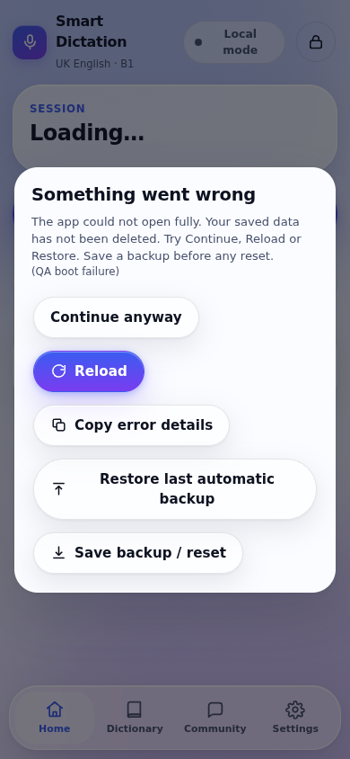

> Historical report. For the current candidate see PHASE1_QA.md. The default PIN example was removed from this document; it is not a server secret.

# Smart Dictation Player — repair and QA report

**Date:** 2026-10-13 UTC
**Delivered app:** `index.html`, **v1.3.0**, **356,440 bytes** (348.1 KiB).
**Observed result:** **85 automated checks PASS; 0 current-suite FAIL.** This is not a guarantee and does not establish real-device compatibility.
**Tools:** jsdom with stubs/fake timers; Node syntax checking and an ES2017 parser; Chromium 138 driven by Playwright; Google Apps Script run with mocked Google services.
**File SHA-256:** `5db053fcec283d62b0453061e7f0aabb02a51ce72b6cbf79d5af03fc114d9acc`

The original repository file was edited in place, not rebuilt. All **20 numbered JavaScript sections**, `sdp.v1`, its migration, and the embedded `gas-source` script remain. Apps Script was repaired/extended, not removed. The application uses no runtime libraries, CDNs or web fonts. Test dependencies are separate in `tests/`.

## Phase 1 — Hotfix and recovery

- Replaced the empty class-token crash first; all ten original class operations now use `U.setCls` with explicit add/remove.
- Late errors show a toast, not the fatal screen; renders and registered handlers are contained, with a 50-entry Diagnostics log.
- Backup and reset are separate steps; reset requires a saved-backup tick, exact `RESET`, and lecturer unlock; automatic copies and recovery data are retained.
- The full boot-error card has Continue, Copy details and Restore controls, plus its own scale-only flex-centred animation.
- Removed the injected Cloudflare script; guarded storage/JSON/date/speech/navigator failures, flushed saves on page hide, and stopped application network calls at load.

**File:** the combined final `index.html` contains these fixes; no numbered manual patches are required.

### Before/after evidence

| Test | PASS / FAIL / NOT VERIFIED | How checked |
|---|---|---|
| Original Local-mode startup | FAIL (original file) | jsdom reproduced the fatal card caused by adding an empty class token. |
| Fix 1.1 alone | PASS | Ran the original file with only the one-line change; no fatal card. |
| Original late-error boundary | FAIL (original implementation) | Source called fatalCard for every window error/rejection; the patched runtime injected-error checks confirm containment. |
| Patched late errors, rejection and failing widgets | PASS | Injected window errors and a throwing handler/render; Settings remained usable and the log was bounded at 50. |
| Original failed emergency download | FAIL (original file) | Download could not run in jsdom; the original handler still removed `sdp.v1` after 600 ms. |
| Patched failed download/reset | PASS | Advanced timers beyond 600 ms; saved data stayed intact. Tested tick + exact RESET separately. |
| Original fatal card at 390 px | FAIL (original file) | Chromium measured x = -163 px after its animation; part of the card was outside the screen. |
| Patched fatal card at 390 px | PASS | Chromium measured x = 16 px, width = 358 px, y ≈ 185.6 px, height ≈ 472.8 px; fully inside a 390 × 844 viewport. |
| Injected script / network at initial load | PASS | Removed `__CF$cv$params` and `cdn-cgi` code; runtime request counts at load were zero (configured cloud included in jsdom). |
| Additional malformed data and DOM-sink checks | PASS | Tested blocked getters/storage, invalid JSON/structures/dates, literal attack strings, and audited all class attribute assignments. |

The error log is in memory for this page, not permanent. Copy it before reloading.

| Test | PASS / FAIL / NOT VERIFIED | How |
|---|---|---|
| Boot, malformed storage, missing browser APIs | PASS | jsdom fixtures plus seven Chromium boot-edge scenarios. |
| Backup/reset and error containment | PASS | Timer advancement, failed-download simulation, throwing events/render. |
| Fatal dialog centring | PASS | Chromium measured animated geometry at 390 px. |
| Physical phone storage eviction | NOT VERIFIED | Requires a phone/browser eviction test; cannot be prevented by JavaScript. |

### Lecturer quick-start

1. Tap the lock icon, enter the lecturer PIN, then tap **Unlock**.
2. Open **Words & planner**, select a list, paste the new words, and **Save draft (replace list)**.
3. Choose **Publish for**: Today, a weekday, a date, or Pin now.
4. Open **Session** and set the number, day, date and title; changes show on Home.
5. Return to **Words & planner → Publish to students → Publish now**; use **Settings & tools → Student link** (cloud) or **Share this list** (no server).
6. Open **Announce & inbox** to read, mark read, save/share private replies; use **Comments** to pin, hide, reply or delete.

**Phase 1 limits:** a browser can refuse storage or evict it. The app warns and keeps an in-memory copy, but closing that page can then lose unsaved memory data. Keep a backup outside the browser. Continue anyway cannot repair the underlying cause of an arbitrary boot exception; Reload/Restore may still be needed.

## Phase 2 — Lecturer control

- Fresh devices seed a unique salted SHA-256 hash for the requested starting PIN; existing changed PINs remain, with 4–8 digit entry, explicit Unlock, lockout and idle/background locking.
- Paste accepts pipes, tabs, quoted CSV and single words; preview/validation, saved paste drafts and published-word snapshots prevent draft changes leaking into students' current lists.
- Kept and extended day/date/pinned planning, eight-week display, copy-week tools, duplicate/rename, drag plus up/down, Undo, TXT/CSV/JSON and the reusable 30-word B1 sample.
- Session controls include typing, a large stepper, day chips/automatic day, date/title and published playback defaults; metadata is attached to player/results/comments.
- Announcements, private inbox, saved/shared private replies and anonymous status comments remain separate; normal locked backups omit lecturer inbox data, drafts and PIN hashes.

**File:** the combined `index.html`, including the updated `gas-source`. Storage remains schema 1 with additive/default repairs; no storage-key rename.

| Test | PASS / FAIL / NOT VERIFIED | How |
|---|---|---|
| Seed/change PIN, lockout and no student edit routes | PASS | jsdom auth/UI checks; mocked server denies privileged unauthenticated actions. |
| Draft/publish isolation, planner, session and Undo | PASS | Real UI handlers driven in jsdom; in-progress session snapshot assertions. |
| Private inbox/comments and locked backups | PASS | Mocked server privacy checks plus student backup/export/import assertions. |
| Lecturer changes list in under 30 seconds | NOT VERIFIED | Exact quick-start provided; physical timed run needed. |

### Lecturer quick-start

1. Tap the lock icon, enter the lecturer PIN, then tap **Unlock**.
2. Open **Words & planner**, select a list, paste the new words, and **Save draft (replace list)**.
3. Choose **Publish for**: Today, a weekday, a date, or Pin now.
4. Open **Session** and set the number, day, date and title; changes show on Home.
5. Return to **Words & planner → Publish to students → Publish now**; use **Settings & tools → Student link** (cloud) or **Share this list** (no server).
6. Open **Announce & inbox** to read, mark read, save/share private replies; use **Comments** to pin, hide, reply or delete.

**Phase 2 limits:** the local PIN is a UI lock on this device, not encryption or protection against the browser/device owner using developer tools. The UI says “This PIN locks this device only.” Keep the lecturer device and full/emergency backups private. Private replies are stored in the inbox/server and sent using Share/Copy, not pushed into a student's app inbox. Dictionary examples are filled only when suitable-length examples exist; the lecturer must review their level and accuracy.

## Phase 3 — Sharing between phones

- Added four setup cards for Copy script, Google Sheet/deployment, saved web-app URL and a plain green/red Test connection result.
- Student links use `#cloud=script-id`, save the connection and clear the hash; no source edit is needed, including links opened while the page is already running.
- List links carry UTF-8 session/word/sentence/meaning/announcement/contact data; long lists split into saved parts with explicit preview/Add, plus optional guarded CompressionStream shortening.
- Default links use plain base64url for old phones; compressed links require newer phones, with the original links retained as the fallback.
- Contact hand-off, honest sync status and polling/outbox are wired; committed-version pointers keep the previous list if a chunk write fails, and the server PIN stays in memory.

**File:** the combined `index.html`. URL storage is `sdp.cloudurl`; a saved URL takes precedence over the legacy source constant.

| Test | PASS / FAIL / NOT VERIFIED | How |
|---|---|---|
| URL wizard / cloud hash / personal contact links | PASS | jsdom UI/string fixtures, persistence and hash handling. |
| Plain/split/shorter list links | PASS | jsdom payload tests plus Chromium native compression/decompression and Add all parts. |
| Large cloud publish, failed chunk and retry | PASS | 1,200 words in mocked Sheets; injected append failure keeps old version and successful retry restores all new words. |
| Live Google, actual Share delivery and two phones | NOT VERIFIED | Deploy and run the exact live/device checklist. |

### Lecturer quick-start

1. Tap the lock icon, enter the lecturer PIN, then tap **Unlock**.
2. Open **Words & planner**, select a list, paste the new words, and **Save draft (replace list)**.
3. Choose **Publish for**: Today, a weekday, a date, or Pin now.
4. Open **Session** and set the number, day, date and title; changes show on Home.
5. Return to **Words & planner → Publish to students → Publish now**; use **Settings & tools → Student link** (cloud) or **Share this list** (no server).
6. Open **Announce & inbox** to read, mark read, save/share private replies; use **Comments** to pin, hide, reply or delete.

### One-time live cloud setup

1. On the published HTTPS page, unlock lecturer mode and open **Settings & tools**.
2. Tap **Copy script**. Create a Google Sheet; open **Extensions → Apps Script** and replace `Code.gs` with the copied source.
3. In **Project Settings → Script properties**, set `ADMIN_PIN` to the lecturer’s chosen server PIN initially, then change it later. This setup value is not displayed by the app UI. Do not put it in a student link.
4. Deploy a **Web app**, execute as **Me**, access **Anyone**; authorise the project and copy the `/exec` URL. Some school/Workspace accounts do not allow Anyone access.
5. Paste/save the URL and tap **Test connection**. A green result verifies a ping, not every feature.
6. **Lock now and unlock again** after changing from Local to Cloud mode: the server must check the PIN before queued lecturer writes can send. Reopen/redeploy after Apps Script source changes.
7. Publish, copy the **Student link from the real published page**, and verify it on a second phone. Do not use the temporary Arena preview URL as your permanent class link.

**Phase 3 limits:** live Google deployment/CORS/quotas, school permissions and actual multi-phone delivery are NOT VERIFIED. The mocked server verified auth, privacy, versioning and chunked list cells (1,200 words), not Google's service. Private OS-sharing delivery requires choosing the correct recipient and pressing Send in the chosen app. Administrators' queued writes wait for lecturer unlock rather than storing a PIN on disk. To honour zero application network requests at load, sync begins on the first tap/key interaction, then polls about every 20–24 seconds while visible and on focus. No QR encoder was added; Copy and Share are available.

## Phase 4 — Player, UK dictionary and device UI

- Speech remains strictly en-GB and prefers local named UK voices; no US fallback is used, and Text mode shows the word with manual Next when speech is unavailable.
- Kept ready/countdown, number/word/sentence/repetition/writing/praise flow and controls; typed answers autosave, restart clears old answers, and results save before closing audio.
- Dictionary audio is accepted only from confirmed UK-suffixed HTTPS entries; UK IPA is paired to that phonetic entry, lecturer meaning wins, and unconfirmed legacy IPA is not labelled UK.
- Cambridge is opened on its own site; kept My words/offline cache and added part of speech/example/spelling notes without scraping Cambridge.
- Kept glass surfaces, themes, S–XL text and the frame/Lite probe; added old-Safari width fallbacks, 44 px controls, input sizing and stronger reduced-motion behaviour.

**File:** the combined final `index.html`; screen-width screenshots are in `qa/evidence/`.

| Test | PASS / FAIL / NOT VERIFIED | How |
|---|---|---|
| 30-word player/controls, resume and results | PASS | jsdom speech stubs and fake timers drive the complete flow. |
| UK voice ranking / UK dictionary parsing | PASS | Missing/delayed/US-only voices and mixed UK/US phonetic fixtures. |
| Small-screen layout and Lite selection | PASS | Chromium 320/390/768 geometry; jsdom low-end/manual Lite choices. |
| iPhone speech/install/interruption and physical printing | NOT VERIFIED | Actual devices/printer required; see exact taps below. |

### Lecturer quick-start

1. Tap the lock icon, enter the lecturer PIN, then tap **Unlock**.
2. Open **Words & planner**, select a list, paste the new words, and **Save draft (replace list)**.
3. Choose **Publish for**: Today, a weekday, a date, or Pin now.
4. Open **Session** and set the number, day, date and title; changes show on Home.
5. Return to **Words & planner → Publish to students → Publish now**; use **Settings & tools → Student link** (cloud) or **Share this list** (no server).
6. Open **Announce & inbox** to read, mark read, save/share private replies; use **Comments** to pin, hide, reply or delete.

**Phase 4 limits:** Chromium phone-sized viewports are not real iPhones. Safari/WebKit/iOS 12, Android 7, audio interruption, volume/silent-switch effects, installation, touch drag and actual low-end speed need device testing. Free dictionary data has no dependable B1 label or UK entry for every word. **Real Cambridge recordings cannot be embedded reliably in one standalone file**: the app does not scrape or hotlink Cambridge text/audio; use Open in Cambridge Dictionary for their recordings.

## Automated test table — final file

Tests use the real file or explicitly described in-memory fixtures. “PASS” means the stated assertion passed, not that every related device/service has been verified. Baseline failure reproduction checks intentionally assert that the old bug exists.

| Test | PASS / FAIL / NOT VERIFIED | How |
|---|---|---|
| 1.1 before: original Local-mode boot shows crash card | PASS | jsdom + fake timers / Node static checks. Assertions and setup in `tests/`. |
| 1.1 after: one-line hotfix alone removes boot crash | PASS | jsdom + fake timers / Node static checks. Assertions and setup in `tests/`. |
| Boot: empty storage | PASS | jsdom + fake timers / Node static checks. Assertions and setup in `tests/`. |
| Boot: corrupt JSON | PASS | jsdom + fake timers / Node static checks. Assertions and setup in `tests/`. |
| Boot: wrong JSON structure | PASS | jsdom + fake timers / Node static checks. Assertions and setup in `tests/`. |
| Boot: storage blocked | PASS | jsdom + fake timers / Node static checks. Assertions and setup in `tests/`. |
| Boot: offline | PASS | jsdom + fake timers / Node static checks. Assertions and setup in `tests/`. |
| Boot: configured unreachable cloud | PASS | jsdom + fake timers / Node static checks. Assertions and setup in `tests/`. |
| Boot: no speechSynthesis | PASS | jsdom + fake timers / Node static checks. Assertions and setup in `tests/`. |
| Boot: no en-GB voice | PASS | jsdom + fake timers / Node static checks. Assertions and setup in `tests/`. |
| Boot: restricted navigator getters | PASS | jsdom + fake timers / Node static checks. Assertions and setup in `tests/`. |
| Boot: throwing speech getter | PASS | jsdom + fake timers / Node static checks. Assertions and setup in `tests/`. |
| 1.1 all ten class call sites use guarded helper | PASS | jsdom + fake timers / Node static checks. Assertions and setup in `tests/`. |
| 1.2 after: late error and rejection do not show fatal card | PASS | jsdom + fake timers / Node static checks. Assertions and setup in `tests/`. |
| 1.2 handler containment, 50-entry limit and Diagnostics | PASS | jsdom + fake timers / Node static checks. Assertions and setup in `tests/`. |
| 1.2 failed screen does not prevent Settings from rendering | PASS | jsdom + fake timers / Node static checks. Assertions and setup in `tests/`. |
| 1.2 actual boot failure retains full card and recovery controls | PASS | jsdom + fake timers / Node static checks. Assertions and setup in `tests/`. |
| 1.3 before: emergency backup silently fails but deletes storage at 600ms | PASS | jsdom + fake timers / Node static checks. Assertions and setup in `tests/`. |
| 1.3 after: failed download and copy fallback never reset or reload | PASS | jsdom + fake timers / Node static checks. Assertions and setup in `tests/`. |
| 1.3 second confirmation requires BOTH tick and exact RESET | PASS | jsdom + fake timers / Node static checks. Assertions and setup in `tests/`. |
| 1.3 result saves and lecturer changes update rolling backup | PASS | jsdom + fake timers / Node static checks. Assertions and setup in `tests/`. |
| 1.3 corrupt primary restores automatic copy and retains corrupt text | PASS | jsdom + fake timers / Node static checks. Assertions and setup in `tests/`. |
| 1.3 pending save flushed on pagehide | PASS | jsdom + fake timers / Node static checks. Assertions and setup in `tests/`. |
| 1.4 flex fatal card uses scale-only animation; confirm keeps translate | PASS | jsdom + fake timers / Node static checks. Assertions and setup in `tests/`. |
| 1.5 injected script removed, gas-source retained, 20 sections kept | PASS | jsdom + fake timers / Node static checks. Assertions and setup in `tests/`. |
| 1.5 zero network requests on load, including configured cloud | PASS | jsdom + fake timers / Node static checks. Assertions and setup in `tests/`. |
| 1.6 invalid dates and malformed backup import are guarded | PASS | jsdom + fake timers / Node static checks. Assertions and setup in `tests/`. |
| 1.6 user strings remain literal text, not executable HTML | PASS | jsdom + fake timers / Node static checks. Assertions and setup in `tests/`. |
| Static: node --check, ES2017 parser, no eval, under 450KB | PASS | jsdom + fake timers / Node static checks. Assertions and setup in `tests/`. |
| 2.1 seeded salted PIN unlocks; existing changed PIN survives migration | PASS | jsdom + fake timers / Node static checks. Assertions and setup in `tests/`. |
| 2.1 five wrong PINs cause five-minute lockout; 8-digit PIN is usable | PASS | jsdom + fake timers / Node static checks. Assertions and setup in `tests/`. |
| 2.1 #lecturer and direct render/edit methods reveal nothing without PIN | PASS | jsdom + fake timers / Node static checks. Assertions and setup in `tests/`. |
| 2.1 detached editing handlers and delayed list rows cannot edit after Lock now | PASS | jsdom + fake timers / Node static checks. Assertions and setup in `tests/`. |
| 2.2 paste handles 120 words, pipes, tabs, CSV quotes and warnings | PASS | jsdom + fake timers / Node static checks. Assertions and setup in `tests/`. |
| 2.2 30-word Saturday assignment, draft isolation and eight-week planner | PASS | jsdom + fake timers / Node static checks. Assertions and setup in `tests/`. |
| 2.2 cloud list update stays queued throughout active session | PASS | jsdom + fake timers / Node static checks. Assertions and setup in `tests/`. |
| 2.3 session typing/day chips update Home, player and comment metadata | PASS | jsdom + fake timers / Node static checks. Assertions and setup in `tests/`. |
| 2.4 private message is absent from public comments, visible only in unlocked inbox | PASS | jsdom + fake timers / Node static checks. Assertions and setup in `tests/`. |
| 2.5 all four anonymous comment statuses persist with safe text and session metadata | PASS | jsdom + fake timers / Node static checks. Assertions and setup in `tests/`. |
| 3.1 setup wizard has four cards, saved URL and red/green response | PASS | jsdom + fake timers / Node static checks. Assertions and setup in `tests/`. |
| 3.2 student hash connects automatically and is cleared without load requests | PASS | jsdom + fake timers / Node static checks. Assertions and setup in `tests/`. |
| 3.3 Unicode link round-trip, explicit preview/Add and split-part assembly | PASS | jsdom + fake timers / Node static checks. Assertions and setup in `tests/`. |
| 3.3 malformed linked data is rejected without a fatal card or list changes | PASS | jsdom + fake timers / Node static checks. Assertions and setup in `tests/`. |
| 3.4 no-cloud contact offers explicit WhatsApp/Email/Share, private content not public | PASS | jsdom + fake timers / Node static checks. Assertions and setup in `tests/`. |
| 3.5 outbox auth uses memory-only PIN, skips locked admin items and flushes student items | PASS | jsdom + fake timers / Node static checks. Assertions and setup in `tests/`. |
| 3.5 sync time advances only after successful state reply | PASS | jsdom + fake timers / Node static checks. Assertions and setup in `tests/`. |
| 4.1 no UK voice never invokes speech, Text mode has visible word/manual Next | PASS | jsdom + fake timers / Node static checks. Assertions and setup in `tests/`. |
| 4.1 UK ranking and utterances stay en-GB; no-UK dictionary audio refused | PASS | jsdom + fake timers / Node static checks. Assertions and setup in `tests/`. |
| 4.2 full 30-word fake-timer dictation, instant marking, pause/resume, result saved | PASS | jsdom + fake timers / Node static checks. Assertions and setup in `tests/`. |
| 4.2 reload mid-session offers continuation with answers and same word | PASS | jsdom + fake timers / Node static checks. Assertions and setup in `tests/`. |
| 4.2 finish saves result before closing speech and queues it while offline | PASS | jsdom + fake timers / Node static checks. Assertions and setup in `tests/`. |
| 4.3 dictionary keeps lecturer meaning, Cambridge link and UK-labelled fallback | PASS | jsdom + fake timers / Node static checks. Assertions and setup in `tests/`. |
| 2.1 Change PIN requires old PIN and new matching PIN; new PIN unlocks | PASS | jsdom + fake timers / Node static checks. Assertions and setup in `tests/`. |
| 2.1 idle/background locks and privileged sheets disappear | PASS | jsdom + fake timers / Node static checks. Assertions and setup in `tests/`. |
| 2.2 rename/duplicate/reorder/delete with Undo retain list and planner data | PASS | jsdom + fake timers / Node static checks. Assertions and setup in `tests/`. |
| 2.4 announcements, expiry and lecturer moderation stay separate from private inbox | PASS | jsdom + fake timers / Node static checks. Assertions and setup in `tests/`. |
| 4.4 automatic Lite mode respects slow/low-memory devices and manual setting | PASS | jsdom + fake timers / Node static checks. Assertions and setup in `tests/`. |
| 2.4 locked backups exclude lecturer private inbox, PIN hashes and drafts; full backup requires unlock | PASS | jsdom + fake timers / Node static checks. Assertions and setup in `tests/`. |
| Apps Script ES2017 syntax | PASS | Apps Script with mock Google services. Assertions and setup in `tests/`. |
| Server rejects unauthenticated publish/inbox/moderation; public reads exclude inbox | PASS | Apps Script with mock Google services. Assertions and setup in `tests/`. |
| Server PIN: correct PIN succeeds, five wrong tries lock for five minutes | PASS | Apps Script with mock Google services. Assertions and setup in `tests/`. |
| Server 1200-word list stores multiple cells under 40K, reads all words/version/plan/session | PASS | Apps Script with mock Google services. Assertions and setup in `tests/`. |
| Server comments sanitize links/digits/formulas and stable retry ids do not duplicate | PASS | Apps Script with mock Google services. Assertions and setup in `tests/`. |
| Server message stays private; authorised inbox read/reply/mark read/delete work | PASS | Apps Script with mock Google services. Assertions and setup in `tests/`. |
| Server failed multi-cell publish leaves committed words/version intact and can retry | PASS | Apps Script with mock Google services. Assertions and setup in `tests/`. |
| Chromium 390px boot and zero load network | PASS | Chromium 138 through Playwright. Assertions and setup in `tests/`. |
| Chromium 390px PIN unlock and no horizontal page overflow | PASS | Chromium 138 through Playwright. Assertions and setup in `tests/`. |
| Chromium 390px session update visible on Home | PASS | Chromium 138 through Playwright. Assertions and setup in `tests/`. |
| Chromium 320px boot and zero load network | PASS | Chromium 138 through Playwright. Assertions and setup in `tests/`. |
| Chromium 320px PIN unlock and no horizontal page overflow | PASS | Chromium 138 through Playwright. Assertions and setup in `tests/`. |
| Chromium 320px session update visible on Home | PASS | Chromium 138 through Playwright. Assertions and setup in `tests/`. |
| Chromium 768px boot and zero load network | PASS | Chromium 138 through Playwright. Assertions and setup in `tests/`. |
| Chromium 768px PIN unlock and no horizontal page overflow | PASS | Chromium 138 through Playwright. Assertions and setup in `tests/`. |
| Chromium 768px session update visible on Home | PASS | Chromium 138 through Playwright. Assertions and setup in `tests/`. |
| Chromium native CompressionStream creates shorter links and retains original fallback | PASS | Chromium 138 through Playwright. Assertions and setup in `tests/`. |
| Chromium native DecompressionStream preview/Add assembles the full 30-word list | PASS | Chromium 138 through Playwright. Assertions and setup in `tests/`. |
| Chromium boot: empty | PASS | Chromium 138 through Playwright. Assertions and setup in `tests/`. |
| Chromium boot: corrupt | PASS | Chromium 138 through Playwright. Assertions and setup in `tests/`. |
| Chromium boot: blocked | PASS | Chromium 138 through Playwright. Assertions and setup in `tests/`. |
| Chromium boot: offline | PASS | Chromium 138 through Playwright. Assertions and setup in `tests/`. |
| Chromium boot: unreachable | PASS | Chromium 138 through Playwright. Assertions and setup in `tests/`. |
| Chromium boot: no-speech | PASS | Chromium 138 through Playwright. Assertions and setup in `tests/`. |
| Chromium boot: no-UK | PASS | Chromium 138 through Playwright. Assertions and setup in `tests/`. |
| Original Chromium fatal card is off-screen (before evidence) | PASS | Chromium 138 through Playwright; measured bounding box {'x': -163, 'y': 161.1328125, 'width': 358, 'height': 260.859375}. Assertions and setup in `tests/`. |
| Chromium 390px Full-mode fatal card centred and within viewport after animation | PASS | Chromium 138 through Playwright; measured bounding box {'x': 16, 'y': 185.578125, 'width': 358, 'height': 472.84375}. Assertions and setup in `tests/`. |

## Remaining verification / honest boundaries

| Test | PASS / FAIL / NOT VERIFIED | How / next check |
|---|---|---|
| Firefox boot/flows | NOT VERIFIED | No Firefox binary was run. Run the same boot scenarios in Firefox. |
| WebKit/Safari boot/flows | NOT VERIFIED | Chromium is not WebKit. Use the iPhone checklist below. |
| Real iPhone UK speech, voice loading and silent switch | NOT VERIFIED | Test voice on an actual phone; see steps below. |
| Real lock screen, phone call/Siri and refresh recovery | NOT VERIFIED | jsdom pause/reload was tested; actual OS interruptions were not. |
| iOS 12 / Android 7 compatibility | NOT VERIFIED | ES2017 and CSS fallbacks checked; neither OS version was run. |
| Add to Home Screen / rotation / keyboard safe area | NOT VERIFIED | Viewport layout was checked in Chromium, not an installed iPhone app. |
| Change the day list in under 30 seconds | NOT VERIFIED | Automated editor/assignment flow passes; no real lecturer stopwatch test. |
| Physical A4 printing / AirPrint | NOT VERIFIED | Existing printable sheet kept; no real printer/AirPrint test. |
| Native touch drag on iPhone | NOT VERIFIED | Desktop-style drag handlers exist; up/down buttons are the touch-safe alternative. |
| Live dictionary API and B1 suitability | NOT VERIFIED | Parsed representative fixtures and verified safe fallback. Actual API data/CEFR appropriateness requires lecturer review. |
| Live Google Apps Script deployment and two-phone sync | NOT VERIFIED | Mock service tests pass; no real Google project was deployed. Follow the one-time setup, publish and open a second phone. |
| WhatsApp, Email, AirDrop and native Share delivery | NOT VERIFIED | Link/payload construction and Chromium compression/import were tested, not external apps or delivery. |
| Native clipboard permissions and iPhone saved backup file | NOT VERIFIED | Copy fallback/reset gating tested; check actual Files/clipboard on the phone. |
| Storage eviction, full disk and OS killing a write | NOT VERIFIED | Blocked storage is handled, but no browser app can prevent eviction/full disk. Save external backups. |
| Very large real Sheets payloads / quotas | NOT VERIFIED | 1,200 words pass against mocked chunked cells; actual execution and request limits still apply. |

### Assumptions and operational notes

- The requested initial PIN is for fresh/unset devices only. Existing changed hashes are intentionally preserved.
- The setup is for one lecturer/class; changing class/server links is an explicit action, not an automatic account system.
- An active dictation keeps its captured words/version/session metadata; queued published state is applied after stop/finish.
- Manual weekday/date choice is preserved; **Use today's day** re-enables automatic day selection.
- Default sharing is old-phone-compatible plain links. Send shorter compressed links only to newer phones; keep the originals for other students.
- Unpublished text is retained as a draft. Publish the edited list and session/planner settings together; in Local mode it still affects this device only.
- Existing history/comment/inbox caps remain. Outbox items are no longer silently dropped at 200. Export important records regularly.
- Local/student backups are personal and do not carry the lecturer's private inbox, draft text or PIN hash. Full/emergency backups include sensitive data: keep them private. Personal restore merges personal work without changing lecturer lists/PIN; full restore requires lecturer unlock.
- Error logs are bounded to 50 entries in memory. Copy them before reload. Storage/network fallbacks cannot provide a blanket guarantee.

## Test on a real iPhone — exact taps

1. **Install:** open the published HTTPS page in Safari → Share → Add to Home Screen → Add. Open its icon. Confirm Home opens without a crash card.
2. **UK voice:** Settings tab → UK English voice → Test voice. Check the displayed voice is UK and you hear it. If missing: iPhone Settings → Accessibility → Spoken Content → Voices → English → United Kingdom; on iOS 12 use Settings → General → Accessibility → Speech → Voices. Download a voice, return, and test again.
3. **Volume/silent switch:** repeat Test voice with media volume up; test with the silent switch both ways and with headphones. Note what this device does; the app cannot reliably detect the switch.
4. **Player:** Home → Start dictation → I'm ready. Check the spoken ready phrase, 3–2–1, Number 1, word, sentence, repeated word and writing time. Try Pause/Play, repeat word/sentence, Slower, Spell, Previous/Next, then Finish early on a practice run.
5. **Typing and refresh:** choose Type my answers and start. Type a few answers; on “neighbour” try `neighbor` to check the UK spelling hint. Refresh/reopen → Continue from word N. Confirm the saved answer and word are retained, then finish and check the result.
6. **Lock/call:** during a word, press the side button to lock the phone. Wait, unlock and return to the app; accept Resume and check the same word. Repeat after a call/Siri interruption.
7. **Rotate:** rotate portrait/landscape while a sheet and keyboard are open. Confirm controls, Close, tab bar and safe-area content remain reachable. Use up/down reorder buttons if touch drag is unavailable.
8. **Backup on a spare/test device:** Settings → Download backup → save to Files, open the file and check JSON exists. Test Share/Copy. Do not reset your lecturer phone just to test: on the test device only, unlock lecturer mode, save a full backup, then Next → tick I saved my backup → type RESET. Restore and check results/lists.
9. **Live class:** on a second phone open the Student link and tap to sync. Publish a new Saturday list/session/announcement from the lecturer device. Check the second phone; start a dictation, publish a new version mid-session, and confirm the old session finishes before the new list opens. Send a private message; confirm it appears in Announce & inbox, never public Comments.

## Files and repeatability

- `index.html`: deploy/download this one file.
- `qa/automated-results.json`: machine-readable 85-check results and file fingerprint.
- `tests/README.md`: exact commands to rerun the tests; dependencies are development-only.
- `qa/evidence/home-390.png` and `qa/evidence/fatal-390.png`: observed Chromium screenshots, not real-iPhone proof.

